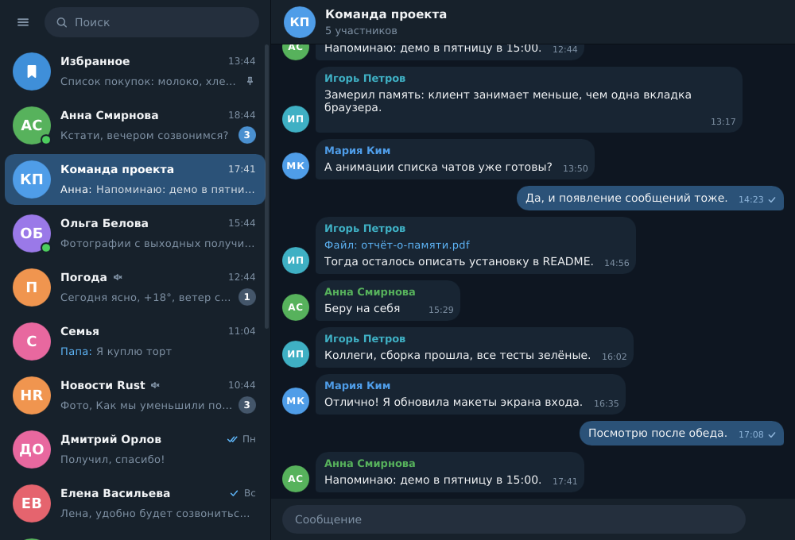
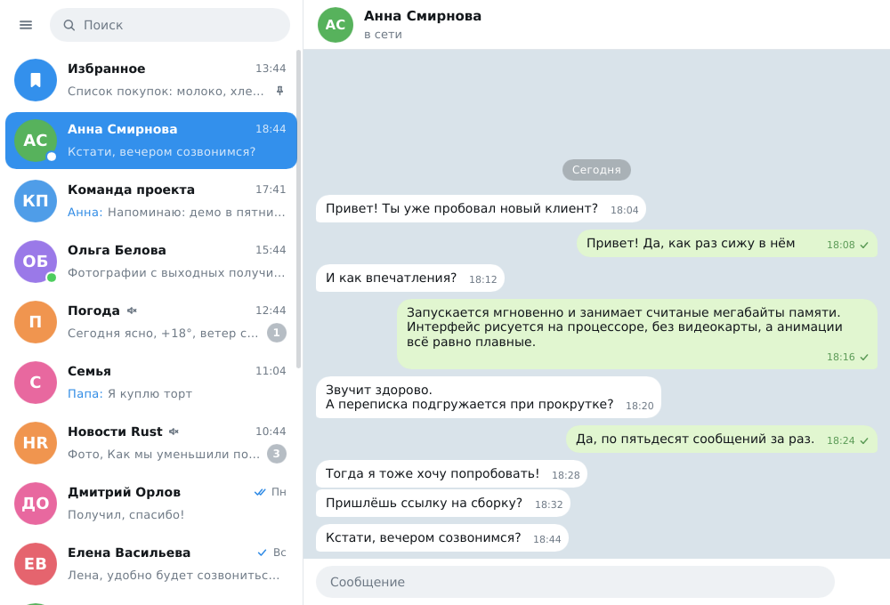

# Ferrogram

Лёгкий настольный клиент Telegram на Rust — для Windows, Linux и macOS.

Интерфейс написан на [Slint](https://slint.dev) и рисуется процессором, без
видеокарты и без браузерного движка внутри. С Telegram программа общается по
протоколу MTProto через библиотеку [grammers](https://codeberg.org/Lonami/grammers),
тоже на чистом Rust.




Снимки сделаны в демо-режиме, переписка на них выдуманная.

## Что умеет

- Вход по номеру телефона, коду и облачному паролю.
- Список чатов: непрочитанные, закреплённые, «без звука», кто в сети и кто
  печатает, поиск по названию.
- Переписка: текст, подгрузка истории при прокрутке вверх, отправка сообщений
  (Enter — отправить, Shift+Enter — новая строка), отметки «отправляется»,
  «отправлено», «прочитано».
- Новые сообщения, правки, удаления и отметки о прочтении приходят сразу.
- Тёмная и светлая темы (по умолчанию как в системе); в узком окне список
  чатов и переписка сменяют друг друга.
- Анимации: появление сообщений, смена экранов, выезд чата, кнопка отправки,
  индикаторы набора и загрузки.
- Щелчок правой кнопкой по сообщению копирует его текст, Esc закрывает чат.

## Чего пока нет

- Фото, видео, файлы и стикеры не загружаются: на их месте подпись («Фото»,
  «Файл: отчёт.pdf»). Отправлять можно только текст.
- Цветные эмодзи: рендерер рисует только контуры символов, цветные шрифты
  эмодзи он не поддерживает.
- Форматирование текста, ответы, реакции, папки, секретные чаты, звонки,
  уведомления.

## Состояние

Версия 0.1, первая. Интерфейс проверен целиком в демо-режиме. С настоящими
серверами Telegram проверено подключение, создание и сохранение ключа
авторизации и отказ на неверные ключи приложения. Вход в настоящий аккаунт и
работа с настоящей перепиской не проверялись: для этого нужен телефон с
учётной записью.

## Установка на Windows

Готовый `ferrogram.exe` собирается автоматически при каждом изменении кода:
вкладка **Actions** репозитория → последний запуск **build** → раздел
**Artifacts** → `ferrogram-windows-x64`. Это один файл, установка не нужна.

Собрать самому:

1. Установить [Rust](https://rustup.rs) (версии 1.92 или новее) и «Средства
   сборки C++» из Visual Studio Build Tools — установщик Rust предложит их сам.
2. В папке проекта выполнить `cargo build --release`.
3. Программа появится в `target\release\ferrogram.exe`.

## Первый запуск

1. Получите ключи приложения: [my.telegram.org](https://my.telegram.org) →
   **API development tools**. Понадобятся `api_id` и `api_hash`.
2. Запустите программу и введите ключи, затем номер телефона, код из Telegram
   и, если включён, облачный пароль.

Ключи можно задать и переменными окружения `TG_API_ID` и `TG_API_HASH`.

Посмотреть интерфейс без аккаунта: `ferrogram --demo`.

### Где лежат данные

| Система | Каталог                                   |
|---------|-------------------------------------------|
| Windows | `%APPDATA%\ferrogram`                     |
| Linux   | `~/.local/share/ferrogram`                |
| macOS   | `~/Library/Application Support/ferrogram` |

Другой каталог задаётся переменной `FERROGRAM_HOME`. В нём три файла:
`credentials` (ключи приложения), `session` (ключ авторизации в Telegram) и
`settings` (выбранная тема). Файл `session` даёт доступ к аккаунту — не
передавайте его никому. Команда «Выйти» в меню завершает сессию и удаляет его.

## Потребление ресурсов

Замеры выпускной сборки на Linux, окно 1000×680, демо-режим:

| Показатель                                   | Значение |
|----------------------------------------------|----------|
| Размер программы                             | 17,5 МБ  |
| Память сразу после запуска, список чатов     | 29–31 МБ |
| из неё собственные данные программы          | 13,5 МБ  |
| Загрузка процессора в покое                  | 0 %      |

Когда в тексте встречается символ, которого нет в основном шрифте (эмодзи,
иероглифы), система подключает запасные шрифты, и их файлы попадают в счётчик
памяти процесса. На проверочной системе с большими шрифтами это добавило
62 МБ. Это отображённые файлы шрифтов, общие для всех программ, а не данные
клиента; сколько их будет, зависит от шрифтов в системе.

Почему мало:

- нет браузерного движка, интерфейс рисуется прямо в окно;
- один сетевой поток и один поток интерфейса;
- сессия хранится в маленьком текстовом файле вместо базы данных;
- в памяти только открытая переписка, а строки списка чатов создаются лишь
  для видимой части;
- анимации работают, только пока что-то движется.

## Устройство

| Файл                      | Назначение                                           |
|---------------------------|------------------------------------------------------|
| `src/main.rs`             | запуск, связь интерфейса с логикой                   |
| `src/store.rs`            | состояние интерфейса: списки чатов и сообщений       |
| `src/backend/telegram.rs` | сетевой поток: вход, чаты, история, обновления       |
| `src/backend/demo.rs`     | демо-режим без сети                                  |
| `src/session.rs`          | хранение сессии                                      |
| `src/format.rs`           | время, подписи, инициалы                             |
| `src/config.rs`           | каталог данных, ключи приложения, настройки          |
| `ui/*.slint`              | интерфейс                                            |

Сетевой поток ничего не знает про интерфейс: он принимает команды и присылает
события (`src/backend/mod.rs`). Демо-режим реализует тот же обмен, поэтому
интерфейс в нём работает так же, как с настоящим аккаунтом.

## Разработка

```
cargo test
cargo run -- --demo
```

На Linux для запуска нужны системные библиотеки `libxkbcommon-x11`,
`libfontconfig` и библиотеки X11 или Wayland.

## Лицензии и условия

- Slint распространяется по лицензии GPLv3, бесплатной Royalty-free или
  коммерческой — выберите подходящую, если будете распространять программу.
- grammers — MIT или Apache-2.0.
- Клиент работает с вашими собственными `api_id` и `api_hash` и обязан
  соблюдать [условия использования Telegram API](https://core.telegram.org/api/terms).
